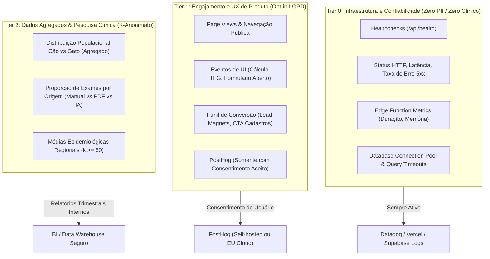

# ADR-004: Telemetria, Métricas e Framework de Privacidade de Dados (Data Squad Tier 0–2)

**Data:** 2026-11-04  
**Status:** Aprovado  
**Autores:** `@data-engineer`, `@analyst`, `@legal-chief`, `@security`  
**Contexto:** Ecossistema Digital Vet do Rim  

---

## 1. Contexto e Motivação

O ecossistema **Vet do Rim** processa dados de três naturezas distintas:
1. **Dados cadastrais humanos (LGPD)**: Nome, CPF, e-mail, telefone de tutores e veterinários.
2. **Dados cadastrais e médicos veterinários**: Nomes de pets, espécies, raças, idades, diagnósticos, laudos e parâmetros laboratoriais (creatinina, ureia, SDMA, etc.).
3. **Métricas técnicas e operacionais**: Requisições HTTP, tempos de resposta, erros de servidor e chamadas de API.

Conforme a Constituição do projeto (`.aiox-core/constitution.md`), o Código de Ética Veterinário (CFMV) e a Lei Geral de Proteção de Dados (Lei nº 13.709/2018 - LGPD), é estritamente proibido enviar dados pessoais de tutores ou dados clínicos identificáveis de pacientes para serviços de terceiros (como Google Analytics, PostHog ou ferramentas de telemetria em nuvem) sem consentimento explícito e sem isolamento técnico comprovado.

Este ADR formaliza a divisão da observabilidade e telemetria em **3 Tiers**, estabelecendo fronteiras de dados e regras de higienização irreversíveis.

---

## 2. Framework de Métricas em Três Camadas (Tiers 0–2)

---

### Tier 0: Infraestrutura e Confiabilidade (Sempre Ativo, Zero PII)

- **Objetivo**: Garantir alta disponibilidade, detecção de incidentes (SRE), SLA/SLO de APIs e segurança da informação.
- **Escopo**:
  - Códigos de status HTTP (200, 400, 401, 403, 404, 429, 500).
  - Latência de rotas (p50, p95, p99).
  - Execução e consumo de memória da Edge Function `parse-laudo`.
  - Rate limiting violations (`429 Too Many Requests`).
  - Purge de eventos de claim de IA expirados.
- **Regras Invioláveis**:
  - `Content-Type`, payloads de formulários e query parameters sensíveis são omitidos dos logs estruturados.
  - O endereço IP do cliente deve ser truncado ou mascarado (anonymized IP) nos logs de acesso.
  - Nenhum UUID de tutor, pet ou clínica deve compor mensagens de erro visíveis ao cliente.

---

### Tier 1: Engajamento e UX de Produto (Opt-in LGPD)

- **Objetivo**: Compreender o uso dos recursos da plataforma para guiar evoluções de produto sem violar a privacidade.
- **Escopo**:
  - Navegação em páginas de ferramentas gratuitas (ex.: `/calculadora-tfg`, `/controle-de-peso`).
  - Disparo de cálculos nas ferramentas (`tool_calculated: { tool: 'tfg', species: 'canino' }`).
  - Cadastro de exames manuais (`exam_created: { origem: 'manual', parameter_count: 5 }`).
  - Adoção de temas claro e escuro (`theme_toggled: { theme: 'dark' }`).
- **Regras Invioláveis**:
  - **Fail-Closed**: O SDK de analytics (ex.: PostHog) **não é carregado nem inicializado** até que o usuário clique em "Aceitar" no `CookieBanner`.
  - **Exclusão de Dados Médicos**: É expressamente proibido enviar como propriedades do evento:
    - Valores numéricos de exames (ex.: `creatinina: 2.4`, `sdma: 18`).
    - Nomes de pacientes (ex.: `pet_name: "Rex"`).
    - CPFs, telefones ou e-mails de tutores.
  - **Mascaramento em Session Replay**: Session replay (se habilitado) deve ter `maskAllInputs: true` e mascarar completamente tabelas e formulários em `/lab/*`.

---

### Tier 2: Inteligência e Dados Agregados (K-Anonimato)

- **Objetivo**: Geração de relatórios agregados de saúde renal animal e métricas de sustentabilidade do negócio (custo zero de IA).
- **Escopo**:
  - Total de laudos processados no mês categorizados por origem (`origem_resultado = 'manual' | 'pdf_local' | 'pdf_ia'`).
  - Percentual de exames caninos vs felinos.
  - Taxa de falha de leitura em OCR/IA por modelo de laudo (estrutural, sem PII).
- **Regras Invioláveis**:
  - Princípio do **k-anonimato** ($k \ge 50$): Nenhuma agregação pública ou de pesquisa clínica pode ser gerada com grupos amostrais inferiores a 50 indivíduos em uma mesma região/clínica.
  - Desassociação criptográfica de identificadores de tutores (`tutor_id` e CPFs jamais transitam em consultas agregadas).

---

## 3. Matriz de Sanitização de Eventos

| Evento | Propriedades Permitidas | Propriedades Estritamente Proibidas |
|---|---|---|
| `tfg_calculator_computed` | `species`, `unit_selected`, `has_sdma` (boolean) | `creatinine_value`, `sdma_value`, `patient_name`, `tutor_id` |
| `manual_exam_saved` | `clinic_id`, `species`, `parameter_count`, `duration_ms` | `pet_name`, `tutor_cpf`, `param_values` (ex: uréia/creatinina) |
| `weight_recorded` | `species`, `has_target_weight` (boolean) | `weight_history_kg`, `tutor_name`, `pet_id` |
| `auth_login_completed` | `role`, `auth_method` (email_password) | `email`, `password_hash`, `tutor_cpf` |
| `ia_quota_consumed` | `clinic_id`, `tokens_consumed`, `model_name` | `pdf_content`, `extracted_json`, `pet_name` |

---

## 4. Conformidade Regulatória e Auditoria

1. **LGPD (Brasil)**:
   - Base legal para Tier 0: Legítimo interesse / cumprimento de obrigação técnica e de segurança da informação (Art. 7º, IX e X).
   - Base legal para Tier 1: Consentimento expresso e inequívoco (Art. 7º, I) via `CookieBanner`.
   - O titular possui direito à revogação do consentimento a qualquer momento nas configurações do sistema.

2. **CFMV (Resoluções 1.138/2016 e 1.321/2020)**:
   - Sigilo profissional de prontuários veterinários garantido no repasse zero de prontuários para provedores de analytics.
   - Histórico clínico do paciente mantido restrito ao tenant da clínica associada via RLS e Foreign Keys.

---

## 5. Implementação Técnica

- O utilitário centralizador de tracking deve residir em `web/src/lib/telemetry.ts`.
- Qualquer chamada deve passar pelo filtro de sanitização `sanitizeEventPayload()`.
- Em ambiente de testes e desenvolvimento, os eventos devem ser encaminhados para `console.debug` ou mock provider sem tráfego de rede.

